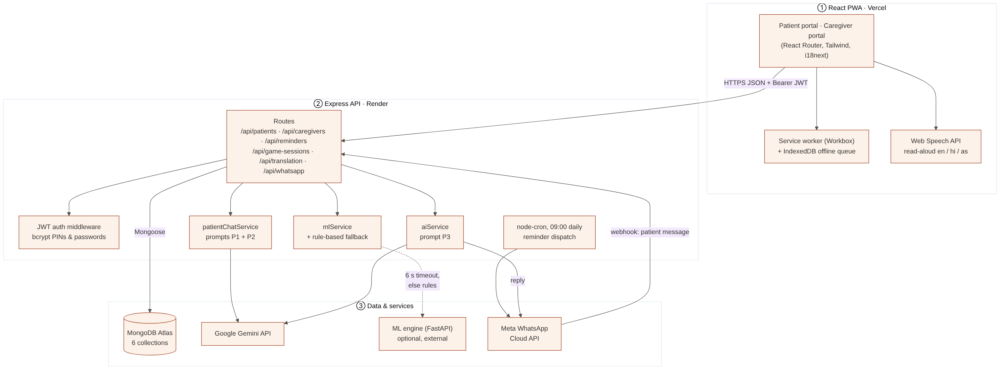

# Smriti (স্মৃতি / स्मृति): AI Memory Companion for Elderly Dementia Patients

**SCSE4041 Mini Project, Milestone 2**

| | |
|---|---|
| Prototype (web app) | **https://smriti-mini-project.vercel.app** (Vercel) |
| Backend API | https://smriti-api-9lj6.onrender.com (Render, free plan; first request after idle takes ~50 s) |
| Repository | https://github.com/Tamanna-57/smriti |
| Original project | https://github.com/gopalrajlohiya11-ui/Smriti (Team Design Divas, Smart India Hackathon 2026, PS SIH26003) |
| Demo logins | Patient: name `Ramesh Sharma`, PIN `1234` · Caregiver: `dr.ananya@smriti.in` / `caregiver123` |

---

## 1. Problem statement

People with early dementia forget medicines, meals and the faces of family. In India's North-Eastern Region the problem is sharper: few neurologists outside Guwahati, patchy 2G/3G internet, and elderly patients who speak Assamese, Hindi or a local language rather than English. Family caregivers have no simple way to see whether the day's routine is being followed.

## 2. Project overview

Smriti is a mobile-first web app (installable PWA) with two portals:

- **Patient portal**: large-button PIN login, today's schedule read aloud, five culturally familiar memory games, a family photo "Memory Bank", and an **AI companion chat** that answers questions such as *"Who is my doctor?"* or *"Which medicine now?"* from the patient's own records, in the patient's language.
- **Caregiver portal**: patient roster with adherence %, per-patient record with a cognitive health score and game telemetry, overdue-reminder alerts, and forms to add patients, reminders and photos.

A WhatsApp webhook lets patients reply "Done" to a reminder, and a daily 09:00 job sends reminder messages (needs a Meta WhatsApp token, see [Status](#5-module-status)).

## 3. Objectives

1. Give the patient one simple place for today's routine, read aloud in their language.
2. Answer the patient's everyday questions with an LLM that is grounded in their real records, not invented facts.
3. Keep memory active with short games whose difficulty adapts to the patient.
4. Let a caregiver see adherence and warning signs at a glance.
5. Keep working on poor networks (offline cache and queued actions).

**Target users:** elderly people with early to moderate memory loss (primary), family caregivers and clinicians (secondary).

## 4. Features, technology and AI

| Area | What is used |
|---|---|
| Frontend | React 19, Vite 8, React Router 7, Tailwind CSS 4, i18next (English, Hindi, Assamese), Recharts, Lucide icons |
| Offline | `vite-plugin-pwa` (Workbox service worker), IndexedDB queue (`idb`) |
| Voice | Browser Web Speech API for read-aloud; MediaRecorder for voice questions |
| Backend | Node.js, Express 5, Mongoose 9, JWT, bcryptjs, node-cron |
| Database | MongoDB (Atlas in production, MongoDB 7 locally) |
| **LLM** | **Google Gemini API** via `@google/genai`: prompts P1/P2 use the cascade `gemini-3.5-flash-lite → gemini-3.5-flash → gemini-flash-latest`; P3 (WhatsApp) uses `gemini-3.6-flash` |
| ML (optional) | External FastAPI engine `dementia-ai-engine.onrender.com` for adaptive difficulty, health score and translation; built-in rule-based fallback when it is unreachable |
| Messaging | Meta WhatsApp Cloud API (Graph API v20.0) |
| Hosting | Vercel (frontend), Render (backend), MongoDB Atlas |

### Prompts (final)

| ID | Name | Where | Model |
|---|---|---|---|
| P1 | Patient Companion Chat | `backend/services/patientChatService.js` | Gemini cascade, temp 0.7, 350 tokens |
| P2 | Voice Question (transcribe + reply) | same file, audio branch | same as P1 |
| P3 | WhatsApp Companion Reply | `backend/services/aiService.js` | `gemini-3.6-flash`, default settings |

Full prompt sheets: [`prompts/final/`](prompts/final). Earlier versions: [`prompts/v1`](prompts/v1), [`v2`](prompts/v2), [`v3`](prompts/v3), taken from the git history of the original project.

## 5. Module status

Checked by running the app locally (MongoDB 7, seeded demo data) on 22 Nov 2026; details in [`test-data/`](test-data).

| Module | What it does | Status | Notes |
|---|---|---|---|
| Patient login | Name + 4-digit PIN, JWT session | Working | Wrong-PIN bypass fixed in Milestone 2. Name is case-sensitive (test T03 fails). |
| Daily schedule & reminders | 10 timed items, tap to complete, read aloud | Working | |
| Cognitive games (5) | Market Day Basket, Daily Routine Sequencer, Faces & Family Recall, Sound & Rhythm Match, Odd One Out | Working | Routine Sequencer "0 cards" bug fixed in Milestone 2. 6 more games are "coming soon" tiles only. |
| Adaptive difficulty | Next level from reaction time and mistakes | Working (rule-based fallback) | External ML engine not reachable from our test environment; fallback rules used. |
| Family Memory Bank | Photo gallery with stories | Working | |
| AI companion chat (P1) | Answers questions from the patient's records | Partly working | Chat window, API and offline keyword fallback verified. Gemini replies not yet verified: no Gemini key in the test environment. |
| Voice question (P2) | Speak instead of type | Not tested | Needs a microphone and a Gemini key. |
| Caregiver dashboard | Roster, adherence, alerts, patient record, telemetry | Working | |
| Caregiver Google login | Google OAuth | Not tested | Needs a Google OAuth client ID. |
| WhatsApp bot (P3) | 09:00 reminders, "Done" replies, AI replies | Partly working | Incoming "Done" marks the reminder (tested with Meta-format payloads). Sending needs a Meta token. |
| Offline PWA | Works with the network off | Working | Tested by switching the browser offline. |
| Languages | English / Hindi / Assamese UI | Working | Hindi reminder-title bug fixed in Milestone 2. |
| Translation & TTS service | Assamese text via ML engine | Fallback only | Returns the original text when the engine is unreachable. |

## 6. Run locally

Requirements: Node.js 18+ (tested on 22), MongoDB (local or Atlas).

```bash
git clone https://github.com/Tamanna-57/smriti.git
cd smriti
```

**Backend**

```bash
cd backend
npm ci
cp .env.example .env        # then edit MONGO_URI, JWT_SECRET, GEMINI_API_KEY
node seed.js                # wipes the database and creates the demo accounts
npm start                   # http://localhost:5000  (health: /api/health)
```

**Frontend** (second terminal)

```bash
cd frontend
npm ci
echo "VITE_API_URL=http://localhost:5000/api" > .env
npm run dev                 # http://localhost:5173
```

No MongoDB installed? `docker run -d -p 27017:27017 mongo:7` and use `MONGO_URI=mongodb://localhost:27017/smriti`.

### Environment variables

| Variable | Where | Needed for | Required |
|---|---|---|---|
| `MONGO_URI` | backend | everything | yes |
| `JWT_SECRET` | backend | login tokens (falls back to a built-in value; set your own) | yes in production |
| `GEMINI_API_KEY` | backend | AI chat P1/P2, WhatsApp P3 (without it: offline fallback replies) | for AI |
| `TZ` | backend | reminder times (`Asia/Kolkata`) | on Render |
| `DEMO_SEED` | backend | `if-empty` / `daily`: auto-seed demo data on a demo database | hosted demo |
| `WHATSAPP_TOKEN`, `WHATSAPP_PHONE_NUMBER_ID`, `WHATSAPP_VERIFY_TOKEN` | backend | WhatsApp bot | for WhatsApp |
| `GOOGLE_CLIENT_ID` | backend | caregiver Google login | optional |
| `ML_SERVICE_URL` | backend | external ML engine (default `https://dementia-ai-engine.onrender.com`) | optional |
| `VITE_API_URL` | frontend (build time) | backend address, e.g. `https://smriti-api-9lj6.onrender.com/api` | yes |
| `VITE_GOOGLE_CLIENT_ID` | frontend | Google login button | optional |

Never commit `.env` files; they are in `.gitignore`.

### Tests

```bash
node code/run_api_tests.js          # 19 API cases → test-data/outputs/api_test_results*.md
node code/run_whatsapp_test.js      # WhatsApp webhook with Meta-format payloads
node code/run_ui_tests.js           # 5 browser tests (needs Playwright + vite preview on :4173)
node code/prompt_experiments.js     # P1 v1/v2/v3 comparison (needs a Gemini key)
```

## 7. Deployment

- **Backend → Render** (`render.yaml`): service `smriti-api`, build `cd backend && npm ci`, start `cd backend && npm start`, env `MONGO_URI`, `JWT_SECRET`, `GEMINI_API_KEY`, `TZ=Asia/Kolkata`, `DEMO_SEED=daily`.
- **Database → MongoDB Atlas** free M0 cluster; Network Access `0.0.0.0/0` (Render has no fixed IP).
- **Frontend → Vercel**: project `smriti-mini-project`, live at https://smriti-mini-project.vercel.app. The root `vercel.json` builds `frontend/` to `frontend/dist`; `VITE_API_URL=https://smriti-api-9lj6.onrender.com/api` is set in the project. Every push to `main` redeploys.

Step-by-step: [`docs/DEPLOYMENT.md`](docs/DEPLOYMENT.md).

## 8. Architecture



More diagrams: [prompt workflow](docs/diagrams/02_prompt_workflow.png), [task decomposition](docs/diagrams/03_task_decomposition.png), [input-output flow](docs/diagrams/04_input_output_flow.png). Written description: [`docs/architecture/`](docs/architecture).

## 9. Repository structure

```text
smriti/
├── README.md
├── CHANGELOG.md                 dated changes made for Milestone 2
├── LICENSE                      MIT, original authors
├── frontend/                    React PWA (unchanged layout)
├── backend/                     Express API, models, routes, services, seed.js
├── prompts/
│   ├── v1/ v2/ v3/              P1 versions from the project's git history
│   └── final/                   P1, P2, P3 prompt sheets
├── code/                        test runners, prompt experiment, ML-engine utility
├── test-data/
│   ├── inputs/                  test cases
│   └── outputs/                 saved real responses and result tables
├── docs/
│   ├── architecture/            architecture notes
│   ├── diagrams/                Mermaid sources + PNG/SVG
│   ├── screenshots/             original 18 screens + milestone2/ test screenshots
│   ├── original_project/        SIH 2026 documents and the original README
│   ├── DEPLOYMENT.md
│   ├── Reel_Script.md
│   ├── Milestone2.pdf
│   └── Technical_Report.pdf
├── render.yaml  vercel.json  deploy.sh
└── .gitignore
```

## 10. Team

| Name | Enrollment no. | Role |
|---|---|---|
| Tamanna Arora | `<ENROLLMENT_NO>` | `<ROLE>` |
| `<MEMBER_NAME>` | `<ENROLLMENT_NO>` | `<ROLE>` |

Team ID: `<TEAM_ID>` · Team name: `<TEAM_NAME>` · Batch: `<BATCH>` · Faculty: `<FACULTY_NAME>`

## 11. Acknowledgement and licence

Smriti was designed and built by **Team Design Divas** (Gopal Raj Lohiya, Aditya Rai Chauhan, Mahir Kumar, Hitarth Garg, Mehak, Diya Gautam) for Smart India Hackathon 2026, problem statement SIH26003, at https://github.com/gopalrajlohiya11-ui/Smriti. This repository keeps that project's full commit history and authorship. The work added for Milestone 2 (bug fixes, tests, prompt documentation, deployment changes, documents) is listed in [`CHANGELOG.md`](CHANGELOG.md) and appears as separate commits. The ML engine is a separate project: https://github.com/adityaraichauhan/Dementia-AI-engine.

The original README declared an MIT licence but had no licence file; [`LICENSE`](LICENSE) adds the MIT text with the original authors as copyright holders.
