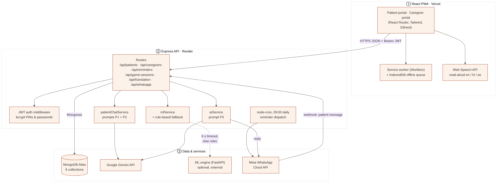

# Smriti architecture

## Layers

| Layer | Code | Responsibility |
|---|---|---|
| React PWA | `frontend/src` | Patient portal (`pages/patient`), caregiver portal (`pages/caregiver`), shared state in `context/AppContext.jsx`, all HTTP calls in `services/api.js` (8 s time-out). `utils/offlineDb.js` queues writes in IndexedDB when offline; `utils/speechUtils.js` reads text aloud. |
| Service worker | `vite.config.js` (VitePWA, Workbox) | Precaches the built app (32 files) so pages open without a network. |
| REST API | `backend/server.js`, `backend/routes/*` | Express 5. Routes: `/api/patients`, `/api/caregivers`, `/api/reminders`, `/api/game-sessions`, `/api/translation` (alias `/api/speech`), `/api/whatsapp`. JSON errors from a global handler. |
| Auth | `backend/middleware/auth.js`, `backend/utils/token.js` | JWT (365-day patient tokens), bcrypt-hashed PINs and passwords, per-IP limit of 10 failed logins per 15 min. |
| AI services | `backend/services/patientChatService.js`, `aiService.js` | Build prompts P1/P2/P3 from MongoDB records and call Gemini; keyword fallback when Gemini fails. |
| ML service | `backend/services/mlService.js`, `translationService.js` | Calls the external FastAPI engine with a 6 s (3.5 s for translation) time-out; on failure uses rules: level up if 0 mistakes and < 3.5 s, level down if ≥ 3 mistakes or > 7 s; health score 40–100 from games played, mistakes and reaction time. |
| Jobs | `backend/jobs/reminderCron.js` | 09:00 daily: one combined WhatsApp reminder per patient plus a daily game link. |
| Data | `backend/models/*` | MongoDB collections `patients`, `caregivers`, `reminders`, `gamesessions`, `memorybankphotos`, `chatmessages`. |

## Request flow: patient asks the AI companion

See `../diagrams/02_prompt_workflow.png`.

1. `PatientChatbot.jsx` sends `POST /api/patients/:id/chat` with the message (or base64 audio) and the last turns.
2. The route resolves the patient (ObjectId, demo alias or name) and calls `generatePatientChatReply()`.
3. The service loads reminders, photos and the last 5 game sessions (2.5 s limit each) and fills the P1 system prompt.
4. Gemini models are tried in order (`gemini-3.5-flash-lite`, `gemini-3.5-flash`, `gemini-flash-latest`); the first reply longer than 3 characters wins.
5. For voice, the `TRANSCRIPTION:` / `REPLY:` labels are split.
6. If every model fails, `getIntelligentFallbackReply()` answers from keywords in Assamese, Hindi or English.
7. The response carries `replySource` so the caller knows which path answered.

## Deployment

React build on Vercel → Express on Render (free, Singapore) → MongoDB Atlas. Gemini, Meta WhatsApp and the ML engine are external HTTPS services. See `../DEPLOYMENT.md`.
